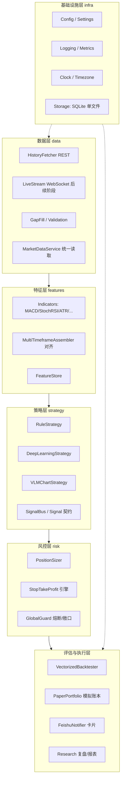

# 个人量化平台（Quant LLM）技术设计文档 v0.1

> 范围：MVP 阶段。只做 **数据获取 / 策略信号 / 事件驱动回测 / 风控（止盈止损 + 仓位管理）** 四个模块，
> 信号通过 **飞书 Webhook 卡片** 推送，并做 **模拟交易（paper trading）** 记账。
> 不做：Web 页面、实盘下单、多交易所、多账户。
> 交易标的：Binance USDT 本位永续合约，首个品种 `ETHUSDT`，其余主流币通过配置快速接入。

---

## 1. 设计目标与非目标

### 1.1 目标

| # | 目标 | 验收标准 |
|---|------|---------|
| G1 | 单一品种端到端跑通 | 从 Binance 拉数据 → 指标 → 信号 → 风控仓位 → 飞书卡片，一条命令完成 |
| G2 | 回测可信 | 无前视偏差（lookahead）、含手续费/资金费率/滑点/杠杆/强平近似，结果可复现（config hash + 数据版本） |
| G3 | 配置化扩展 | 新增一个交易对 = 改 YAML；新增一个策略 = 实现一个 `Strategy` 子类 |
| G4 | 数据一次采集多处复用 | 历史（REST 批量）+ 实时（WS 增量）写入同一存储，回测与实盘信号读同一份数据契约 |
| G5 | 三类策略可插拔共存 | 规则 / 深度学习 / 大模型看 K 线，统一输出 `Signal`，走同一套风控与回测管线 |

### 1.2 非目标（MVP 明确不做）

- 实盘下单、API Key 签名交易接口、账户余额同步（仅本地模拟账本）。
- Web Dashboard、前端、数据库服务化（本地 SQLite 单文件即可，见 §4.4）。
- 高频/做市（周期最小 1m，主要 15m/1h/4h/1d）。
- 期权、现货、跨所套利、组合级多品种联合优化（先做单品种 + 全局敞口约束）。

### 1.3 关键约束（贯穿全文）

1. **只用已收盘 K 线（closed bar）**：WS 的 `kline` 流在未收盘时每 ~2s 推一次，只有 `k.x == true` 的帧才可产生信号，否则回测与实盘口径不一致。
2. **多周期决策的时序对齐**：4h 指标只能在该 4h bar 收盘后可见，且在更细周期（15m）上回放时必须用 `merge_asof(direction='backward')` 做 as-of join，禁止 `ffill` 未来值。
3. **信号 → 成交的延迟建模**：回测里信号在 bar N 收盘产生，成交按 bar N+1 的 open（或 open + 滑点）计算，绝不允许用 bar N 的 close 成交 bar N 的信号。
4. **杠杆账户的风险来自强平而非爆仓**：必须建模维持保证金率与逐仓强平价近似。

---

## 2. 总体架构

### 2.1 分层与依赖方向



依赖原则：**上层依赖下层的抽象接口（Protocol/ABC），不依赖具体实现**；`data` 不知道 `strategy` 存在；`risk` 不 import 任何交易所代码；`notifier` 只消费 `Signal + Position`，不参与决策。

### 2.2 运行形态

三个独立进程/入口，共享同一套库：

| 入口 | 命令 | 职责 |
|------|------|------|
| 数据服务 | `quant backfill` / `quant check-data` / `quant exchange-info` | 分页补历史并落 SQLite / 覆盖率与跨周期一致性校验 / 查看交易规则 |
| 数据流（后续阶段） | `quant data stream` | 常驻 WS 落盘 + 收盘时触发信号 |
| 研究回测 | `quant backtest --strategy rule_v1` | 事件驱动回测、参数扫描、报告输出 |
| 信号推送 | `quant live --strategy rule_v1` | 订阅收盘事件 → 风控 → 飞书卡片 + 模拟账本更新 |

### 2.3 事件流（实时链路）

```
WS kline(ETHUSDT,15m, x=true)
  → BarClosed 事件
  → MTF 对齐（1m 聚合 15m/1h/4h，全部只取已收盘）
  → Strategy.on_bar(features) -> Signal | None
  → RiskGate.check(signal, portfolio) -> Decision(放行/否决/调整数量)
  → PaperPortfolio.apply(decision)  # 模拟持仓、止盈止损状态机
  → FeishuNotifier.send(card)       # 入场卡 / 出场卡 / 否决原因卡
```

---

## 3. 核心数据契约

所有模块只通过这些 dataclass 交换数据（UTC，纳秒时间戳统一为 `pd.Timestamp` tz-aware UTC）。

```python
Bar          # (symbol, interval, ts_open, ts_close, open, high, low, close,
             #  volume, quote_volume, taker_buy_volume, is_closed, src: rest|ws)
FeatureView  # (symbol, base_interval, ts, df: 基础周期特征 + 各高周期 *_htf 列)
Signal       # (id, ts_signal, symbol, timeframe, strategy, action: open_long|open_short|
             #  close_long|close_short, direction, strength: [0,1], price_ref,
             #  stop_loss, take_profit[], reason_text, meta{})
RiskDecision # (signal_id, approved, qty_base, notional_usdt, leverage, margin_mode,
             #  sl, tp[], reject_reason[])
Position     # (symbol, side, qty, entry_price, entry_ts, liq_price, sl, tp, pnl_unreal, ...)
Fill         # (ts, symbol, side, qty, price, fee_usdt, reason: signal|sl|tp|liq|flat)
```

约定：
- `Signal` 只表达"意愿"，**不带数量**；数量一律由风控层给出。这是策略与风控解耦的关键。
- 每个 `Signal` 携带 `reason_text` 与 `meta`，直接用于渲染飞书卡片，避免通知层反查策略。
- 回测与实时使用**同一个 `Strategy` 实现与同一个 `RiskDecision` 生成函数**，只换数据来源与撮合引擎。

---

## 4. 数据获取模块

### 4.1 选型：Binance 官方接口 vs CCXT

前提：**已确定长期只使用 Binance USDT-M 合约**，不需要跨所可移植性。

| 维度 | 官方 REST/WS 直连（自研薄客户端 / `binance-futures-connector`） | CCXT (`ccxt` + `ccxt.pro`) |
|------|---|---|
| 跨所抽象收益 | 本项目**用不到**（单交易所，收益为 0） | 核心价值，此处为纯开销 |
| Binance 专有字段 | 完整：`markPrice`、`fundingRate`、`takerBuyVolume`、`openInterest`、`premiumIndex`、`forceOrder`(强平流)、`depth` 增量 | 部分丢失/需 `unsafe` 接口；`fetchFundingRateHistory` 有，但标记价、强平流、实时持仓量等非统一覆盖 |
| K 线收盘语义控制 | 直接读 `k.x`，自己决定是否接收未收盘 bar，语义清晰 | `watchOHLCV` 返回统一结构，闭盘标记需从 `info` 里挖，且各版本行为有差异 |
| 限速（rate limit） | 直接按 `X-MBX-USED-WEIGHT` 头自适应，精确 | 内置静态 `rateLimit` 队列，与自研重连/退避容易互相干扰 |
| 性能/延迟 | 帧解析最少一跳，无字典重映射 | 每次调用有 format/parse 开销（高频路径明显） |
| 维护成本 | 需自己维护 ~400 行客户端 + 订阅管理 + 重连 | 依赖跟随上游升级，接口偶有 breaking change；体积大 |
| 调试可见性 | 原始 payload 全在手，易定位 | 黑盒转换，回测与实时不一致时难查 |
| 上手速度 | 稍慢 | 很快 |

**结论：主链路走官方接口直连，不引入 ccxt 作为数据主通道。**

具体方案：
1. **REST**：自研薄客户端（`httpx` + 权重预算器 + 指数退避），或直接用官方 `binance-futures-connector`（`binance_usdm`）包一层。推荐自研薄客户端，因为要接 `exchangeInfo`/`fundingRate`/`openInterestHist` 等多种端点并统一缓存。
2. **WS**：`websockets` 库 + combined stream（`/stream?streams=...`）+ 看门狗心跳。
3. **CCXT 的定位**：保留为**可选的开发期校验工具**（例如拉同一区间对比官方结果做数据完整性对账），不进入生产链路，避免版本耦合。

> 唯一例外：若未来要接 OKX/Bybit 做数据源互备，再引入 ccxt，并把 `MarketDataService` 作为唯一读取面，实现层可替换——本设计已通过接口预留了这个位置。

需要覆盖的 Binance USDT-M 端点：

```
Base: https://fapi.binance.com
GET /fapi/v1/exchangeInfo          # 品种规则: tickSize/stepSize/minQty/minNotional
                                   #   + maintMarginPercent/liquidationFee/requiredMarginPercent → 驱动强平近似与杠杆上限
GET /fapi/v1/klines                # 历史K线, interval=15m|1h|4h|1d, limit<=1500
GET /fapi/v1/fundingRate           # 历史资金费率（回测成本）
GET /fapi/v1/premiumIndex          # 最新标记价/资金费率（实时风控）
GET /fapi/v1/openInterestHist      # 可选：持仓量特征

WS: wss://fstream.binance.com
combined stream: ethusdt@kline_15m / kline_1h / kline_4h / kline_1m
                 ethusdt@markPrice@1s        # 强平距离实时监控
                 ethusdt@aggTrade            # 可选，成交明细
                 ethusdt@forceOrder          # 可选，强平事件
```

### 4.2 历史数据回填（backfill）

已实现为 `quant backfill`（`src/quant/data/backfill.py`），流程：

```
1. 读 config/symbols.yaml 的 (symbol, intervals, since)；--symbol/--start/--intervals 可覆盖
2. 先刷新并缓存 SymbolSpec（exchangeInfo，24h TTL），交易规则随数据一起落库
3. 分页拉取 /fapi/v1/klines：limit=1500，游标 = 本页末根 ts_open + 周期
4. 丢弃未收盘 bar 后 upsert 落库；end_ms 按请求区间截断，避免越过 --end 写入
5. 续传判据：仅当库内最早 ts_open <= 请求起点时，才从水位线（MAX(ts_open)）之后续拉；
   请求更早历史时一律从请求起点重拉，靠 upsert 优先级去重
6. 回填 /fapi/v1/fundingRate（limit=1000，游标按 funded_at_ms 推进）
```

实测约束（均已写入代码注释，勿凭直觉改动）：

- **`exchangeInfo` 忽略 `symbol` 查询参数**，始终返回全量 920 个品种（weight=20），必须本地按 symbol 筛选；`/fapi/v1/leverageBracket` 才给逐档保证金，但它需要签名（无 Key 时 401），故强平口径取 `exchangeInfo` 的最高档 `maintMarginPercent`（ETHUSDT=2.5%），比第 1 档更保守。
- **`closeTime = openTime + 周期 − 1ms`**（实测 15m 全量恒为 899999ms），因此收盘判定用 `closeTime < now_ms` 严格比较；若用 `<=` 会把仍在成形的末毫秒 bar 当作已收盘写入。可见时刻一律按 `ts_open + 周期` 计算，不依赖 `ts_close_ms`。
- 429 → 退避并遵守 `Retry-After`；418/451/403 → 判为封禁或代理节点被 Cloudflare 拦截，换出口节点而非重试；权重以本地估算与响应头 `X-MBX-USED-WEIGHT-1M` 的较大者为准。

**完整性校验（必须做）**：`quant check-data` 对每个周期按交易所 interval 网格生成期望 `ts_open` 序列并与实际集合做差，覆盖率 < 100% 时禁止回测（防止用静默缺失数据得出虚假收益）；同时用基础周期聚合出高周期 OHLC 与交易所直接返回的高周期 bar 比对，偏差超阈值的 bar 会打印时刻清单。**实测该比对不是形式**：ETHUSDT 2024-10-28 20:00 与 21:00 两根 1h bar 是交易所侧的聚合错误（只覆盖了部分 15m 数据，收盘价偏差最大 24.78），会连带影响该 4h bar 的 open。多周期特征直接读交易所值，因此这类异常必须显式暴露而不是静默吞掉。

### 4.3 实时流（live stream，后续阶段）

> 本轮 MVP 只做 REST：信号在 bar 收盘后由定时任务触发一次 REST 拉取即可，无需常驻连接。以下为接 WS 时的既定设计，`prio` 覆盖规则与 `is_closed` 判定已按此预留。

- **订阅管理**：单连接多流；品种/周期变更通过 `SUBSCRIBE` 命令动态增删。
- **收盘判定**：仅 `k.x == true` 才发布 `BarClosed`；未收盘帧只更新内存里的 `running_bar`（供风控看盘中最大不利）。
- **断线重连**：WS 无历史保证，重连后**必须 REST 补齐断线区间**再恢复事件流（"resync 闸门"，期间不发信号）。
- **看门狗**：`isFloat()`/`ping-pong` + 空闲 120s 强制重连；交易所 24h 断开属正常，靠重连兜住。
- **时钟**：启动与每 30min 调 `GET /fapi/v1/time` 计算 `server_offset`，所有事件时间以服务器时间为准（本地时钟漂移会造成 bar 错位）。

### 4.4 存储

| 内容 | 介质 | 说明 |
|------|------|------|
| K 线、资金费率、模拟账本、信号与卡片发送日志、元数据（同步水位 / exchangeInfo 缓存 / 数据集版本） | **SQLite 单文件 `data/quant.db`** | 一处存放、支持事务、备份即拷文件 |
| 实时最新值 | 进程内 ring buffer | MVP 单进程，无需 Redis |

```sql
-- bars: 主键即"同 (品种, 周期, bar) 唯一"，天然幂等
CREATE TABLE bars (
  symbol TEXT NOT NULL, time_interval TEXT NOT NULL, ts_open_ms INTEGER NOT NULL,
  ts_close_ms INTEGER NOT NULL, open REAL, high REAL, low REAL, close REAL,
  volume REAL, quote_volume REAL, taker_buy_volume REAL, trades INTEGER,
  is_closed INTEGER NOT NULL, src TEXT NOT NULL, prio INTEGER NOT NULL,
  PRIMARY KEY (symbol, time_interval, ts_open_ms)
);
CREATE TABLE funding (
  symbol TEXT NOT NULL, funded_at_ms INTEGER NOT NULL, funding_rate REAL,
  mark_price REAL, rate_type TEXT, interval_h REAL, src TEXT,
  PRIMARY KEY (symbol, funded_at_ms)
);
CREATE TABLE meta (key TEXT PRIMARY KEY, value TEXT NOT NULL);   -- 水位线、SymbolSpec 缓存 + 抓取时间
```

列名刻意避开 `interval`/`rank`：二者在 DuckDB/Postgres 等引擎里是关键字或易冲突，迁库时不必再改 SQL。

**写入即 upsert**：`INSERT ... ON CONFLICT(symbol, time_interval, ts_open_ms) DO UPDATE SET ... WHERE excluded.prio >= bars.prio`。
`prio = 2*is_closed + (src == 'rest')`，一条语句同时表达两条覆盖规则：**已收盘覆盖未收盘**、**REST 覆盖 WS 尾 bar**（下一轮接 WS 时规则已就位）。

> 选型说明：本项目数据量级为「单品种 15m ≈ 3.5 万行/年」，全部周期与品种合计不超过百万行。SQLite 在此量级下用 `pd.read_sql_query` 读入 pandas 的耗时可忽略，而它换来了事务、幂等 upsert、单文件备份与零运维。列式存储（Parquet/DuckDB）的优势要到多品种多年 1m 数据（千万行级、需列裁剪与全表扫描）才体现，届时 `MarketDataService` 是唯一读取面，替换存储实现不影响上层。原设计的 Parquet + DuckDB 方案据此调整。

**数据集版本化**：`dataset_version = sha1(按 key 排序拼接的 "symbol|interval|rows=min|max_ts" + funding 同格式)`，由 SQL 聚合得出（**不含 mtime**，保证同数据同 hash），回测报告必须打印该值。

---

## 5. 特征与指标层

- 指标计算全部放在 `features/indicators.py`，用纯函数（输入/输出 `pd.Series|DataFrame`），**策略层不得内联计算指标**，保证回测与实时口径一致。
- 基础实现优先 `pandas` + `numpy`（自研，避免 TA-Lib 安装负担）；需要加速再上 `polars`/`numba`。

指标清单（MVP）：

```
MACD(close, fast=12, slow=26, signal=9) → macd, macd_signal, macd_hist
StochRSI(RSI=14, stoch=14, k=3, d=3)    → srsi_k, srsi_d
EMA/SMA(n), ATR(n=14), ADX(14), Bollinger(20,2), VWAP(会话), 
Return/rolling vol(20), 成交量比 vol_ratio, 资金费率, 标记价-指数价基差
```

多周期装配（`MultiTimeframeAssembler`）：

```
输入: base_interval=15m, high=[1h, 4h]
规则: 每个周期都先把 bar 换算成"可见时刻" t_vis = ts_open_ms + 周期毫秒，
     两侧统一用该定义（不混用库里的 ts_close_ms：它是 openTime+周期-1ms，
      同窗口内虽也能对齐，但依赖交易所的 -1ms 约定，换数据源即失效）；
     df_15m = merge_asof(df_15m, df_1h_ind, on='t_vis', direction='backward',
                         allow_exact_matches=True)
     必须允许 exact match：15m(20:45) 与 1h(20:00) 同在 21:00 可见，
     若禁止 exact 则 15m 只能用前一小时的 1h 值，凭空滞后一个周期
     高周期列命名 macd_hist_htf_1h / srsi_k_htf_4h，杜绝 shift 负值
校验: 单元测试断言"任意时刻可见特征 == 该时刻及之前数据独立计算结果"（防前视测试）
```

---

## 6. 策略信号模块

### 6.1 统一接口

```python
class Strategy(Protocol):
    name: str
    required_intervals: list[str]
    def warmup_bars(self) -> int: ...
    def on_bar(self, fv: FeatureView, ctx: StrategyContext) -> Signal | None:
        """只在 BarClosed 时调用；实时与回测同一入口。"""
```

`StrategyContext` 提供只读的历史窗口、当前模拟持仓、账户权益——策略可以"知道"是否已持仓，但**不直接下单**。

### 6.2 策略 A：多周期规则（MVP 首选，先跑通全链路）

示例逻辑（`rule_v1`，参数全部来自 YAML）：

```
趋势过滤（4h）: macd_hist > 0 且 EMA(20) > EMA(60)
中期确认（1h）: StochRSI_k > 20 且向上交叉（脱离超卖区，非单纯金叉）
入场触发（15m）: MACD 柱由负转正 或 收盘上穿 EMA(20)，且 ATR(15m) 处于近 20 根中位以上（避免死水）
多头入场 → open_long
止损 = entry - k1*ATR(1h)，止盈 = entry + k2*ATR(1h)（或分级止盈）
出场: 4h 趋势翻转（macd_hist < 0 连续 m 根）/ 触发止损止盈 / 时间止损（持仓 > N 根未达 TP）
空头镜像，可选关闭。
```

规则引擎以 **声明式条件树** 表达（YAML → 条件组合 AND/OR），新增规则不改代码；`reason_text` 由条件树自动渲染，便于卡片展示。

### 6.3 策略 B：深度学习策略

```
输入:  固定长度窗口（如 128 根 15m）的归一化特征序列（价格用对数收益、量、指标、资金费率、标记价基差）
标签:  Triple-Barrier（Lopez de Prado）：以 k*ATR 设置上下障碍与时间障碍，
       先触及哪个决定类别；或未来 h 根收益分位数（回归）
模型:  基线 LightGBM/XGBoost（tabular，先建立可信基线）
       → 序列模型 LSTM/TCN/小型 Transformer（时序）
输出:  P(long), P(short), P(no-trade) → 概率校准（isotonic/Platt）→ 阈值 → strength
防过拟合（强制）:
  - Walk-forward：训练/验证/测试严格按时间顺序滚动，禁止随机 shuffle split
  - Purged K-Fold + embargo：训练集与测试集之间留 ≥ 标签最大跨度 的隔离带，避免标签重叠泄漏
  - 特征与标签的标准化统计量只在训练集上 fit
  - 参数/模型选择用"样本外净值 + 交易成本后"指标，而非 AUC
上线:  模型产物 `artifacts/{strategy}/{run_id}/model.pkl + train_meta.json`（含数据版本、特征列表、
       训练窗口、指标），推理时校验特征一致性；训练→回测→模拟交易→（未来）实盘 逐级晋级
```

数据管线复用同一 `FeatureView`，推理路径 `DeepStrategy.on_bar` 只做前向 + 阈值，不做重训练。

### 6.4 策略 C：大模型识别 K 线（VLM）

> **角色修订**：经外部证据评估，VLM **不作为端到端价位决策器**（2026 年多模型评测显示"预测视野绑定失败"与方向偏置），
> 而降级为 **形态/市场状态标签器 + 战术否决器**；价位与数量一律由 `risk/stops.py`、`risk/sizing.py` 计算。
> 论证、模型选型（API vs 本地 Qwen3-VL-8B）、成本测算与 Go/No-Go 验证协议见 `docs/vlm_chart_strategy_feasibility.md`。

```
触发: 信号驱动 —— 仅当 rule_v1/dl_v1 产出候选 Signal 时调用（成本比"每根 bar 调用"低 6~8 倍）
渲染: matplotlib 蜡烛图（近 120 根，含成交量 + MACD/StochRSI 副图 + 关键水平线，标注候选入场点与结构位），
      输出 PNG（固定尺寸/风格/字体，缓存到 data/charts/，同一 bar 幂等只渲染一次）
提示: 结构化输出（JSON Schema 强制），只允许离散、无量纲标签：
      {pattern: enum, regime: trending|range|shock, setup_validity: 0|1,
       veto: bool, veto_reason: str, no_trade: bool, confidence_raw: 0-1}
      —— 禁止输出 entry/stop/targets 价位；no_trade 必须是合法输出，否则模型会被迫编造理由
护栏: 1) confidence_raw 须经历史样本外校准（温度缩放/isotonic），未校准值不得用于仓位缩放
      2) veto=true 或 setup_validity=0 → 拒绝该候选，发否决原因卡
      3) 默认 research_only=true，未通过 Gate 1~4（见配套文档）前不进实时链路
可观测: 每次调用记录 prompt hash、模型、token、耗时、图像路径、原始响应 → SQLite，便于复盘"模型为什么这么想"
评估: 唯一判据是"在 rule_v1/dl_v1 之上是否带来统计显著的增量"（Δ成本后 Sharpe、标签 IC/AUC，
      配随机标签 permutation 对照组），而非它自身能否独立盈利
成本: 图像 token 单价 × 每日调用数需在配置里设日预算上限，超预算自动降级为规则策略
```

> 三个策略输出同为 `Signal`，可用同一套回测器与同一套风控，甚至做**信号投票/集成**（`EnsembleStrategy` 预留）。

---

## 7. 回测模块（事件驱动）

> 选型说明：**采用事件驱动引擎，不用向量化回测。**
> 理由：① 策略接口 `on_bar` 与实时链路完全同构，回测与实盘共用同一份策略/风控代码，消除口径分裂；
> ② 本项目有分批止盈、保本移损、chandelier 跟踪、时间止损、反手、资金费、强平这些**带状态的路径依赖**，
> 向量化式子（`pos.shift(1)*ret - cost`）天然表达不出来，硬套会让净值与逐笔明细永久对不上；
> ③ 数据量级小（单品种 15m 约 3.5 万行/年，全区间约 10 万根），逐 bar 事件循环耗时可忽略。
> 代价是比向量化慢，用 numpy 数组预取 + 避免在循环内构造 DataFrame 来控制；指标仍按周期**预计算**为列（第 5 节，含可见时刻定义），循环内只查表，这样既保留事件驱动的语义清晰度，又不引入前视。

### 7.1 事件循环

```
事件类型（单一优先级队列，按 (ts, seq) 弹出）:
  MarketEvent(bar)      数据源推送一根"已收盘"bar —— 唯一的时间推进者
  SignalEvent(signal)   策略 on_bar 产出（可能为空）
  RiskEvent(decision)   风控闸门裁决：批准/裁剪/否决
  OrderEvent(order)     待成交委托（市价/止损/止盈），带有效期
  FillEvent(fill)       成交回执（部分成交、费用、滑点）
  TimerEvent            资金费结算点(UTC 00/08/16)、时间止损、日报

循环骨架:
  for bar in feed:                              # 严格时间递增，只喂已收盘 bar
      portfolio.mark_to_market(bar)             # 先更新权益与浮盈、强平距离
      emit TimerEvent(若 bar 跨过资金费结算点)
      for ev in drain_queue():
          MarketEvent  -> strategy.on_bar(fv)      -> SignalEvent
          SignalEvent  -> riskgate.evaluate(...)   -> RiskEvent
          RiskEvent    -> portfolio.submit(...)    -> OrderEvent
          OrderEvent   -> execution.execute(order, bar) -> FillEvent
          FillEvent    -> portfolio.on_fill(fill)  -> 更新 Position / 触发挂单更新(SL/TP/trail)
      exit_manager.update(bar, positions)       # SL/TP/跟踪/时间止损 → 生成平仓 Order
输出: equity 序列（每 bar mark）、fills 明细、positions 生命周期、metrics、参数敏感性数据
```

**无前视由构造保证**：策略在第 N 根 bar 上只能看到 `feed` 已弹出的 N 及之前的数据；不存在"整表传入策略"的路径。这条比向量化实现更难写错。

### 7.2 撮合与成本模型（ExecutionEngine）

```
1. 信号在第 N 根 bar 收盘产生 → 委托在 N+1 根生效 → 成交价 = next.open × (1 ± slippage_bps/1e4)
2. 跳空处理：若 next.open 已越过挂单价（SL/TP/limit），按 open 成交而非挂单价 —— 否则等于凭空获得有利价格
3. bar 内路径假设：只有 OHLC 时按 "open→(high/low)→close" 的保守路径判定；
   同一根 bar 同时触及 SL 与 TP 时取 SL（可配置 sl_first_on_conflict），并在报告显式标注该偏差方向；
   回填 1m 数据后切换为逐 1m 判定（settings.backtest.intra_bar_path: exact_1m）
4. 手续费：taker/maker 按 fill 名义值分别计，反手按两笔计
5. 资金费：对每个结算点 s ∈ (entry_ts, exit_ts]，cash -= sign(pos) × qty × mark_s × rate_s
   （mark_s 用该结算点前最近已收盘 bar 的 close 近似；rate 来自 funding 表，过滤 rate_type='Regular'）
6. 部分成交：MVP 假设流动性无限（市价全成），但 Fill 结构支持 qty 分批，为 TP1 平 50% 留出位置
7. 强平：liq ≈ entry × (1 ∓ (1/lev − mmr − taker_fee))；持仓期 high/low 触及即按 liq 平，
   实现亏损 ≈ −保证金（另计强平手续费）；开仓前若 liq_dist < 1.5 × sl_dist 则拒绝或降杠杆
8. 无 next bar 的信号（区间末尾）必须丢弃并计数上报，不允许静默
```

**净值以 Fill 账本 + 未平仓 MTM 为唯一真相**；另用 `pos.shift(1)*log_ret − cost` 的向量化算法做一次交叉校验，两者相对误差应在 1e-6 量级（只用于回归测试，不作为口径来源）。

### 7.3 绩效指标

```
收益: 总收益、年化(CAGR)、月度胜率、盈亏比(payoff ratio)、profit factor
风险: 最大回撤、回撤持续时间、年化波动、下行波动、VaR/CVaR(95)
风险调整: Sharpe(用 log ret, 按 bar 频率年化 √(bars_per_year))、Sortino、Calmar
交易: 平均持仓时长、换手率、单笔盈亏分布、交易次数、月均信号数、按 FillReason 分组的出场分布(SL/TP/时间/强平)
稳健性: 样本外/样本内净值比、参数敏感性（±20% 参数收益衰减）、
       滚动窗口 Sharpe 分布、Monte-Carlo 交易序列重排的回撤分位数（必备）
成本压力测试: 手续费/滑点 ×1 / ×2 / ×4 三档后是否仍为正期望
```

### 7.4 复现性

`quant backtest` 生成的 `reports/{run_id}/` 内含：`run_meta.json`（config 快照 hash + dataset_version + 事件顺序种子/随机种子 + 引擎版本）、`metrics.json`、`equity.csv`、`fills.csv`、`chart.html`（plotly 静态页，浏览器打开即可，无需 web 服务）。产物一律用 CSV/JSON 而不用 Parquet，与"数据只用 SQLite 落库"的约定保持一致。同一 config + 同一 dataset_version 必须产出逐字节一致的 metrics（连跑两次校验）。

---

## 8. 风控模块

风控是**独立于策略的强制闸门**，任何 `Signal` 必须经过它才能进入账本与通知。

### 8.1 仓位管理（Position Sizing）

可插拔 `Sizer`，配置选择：

| 方法 | 公式 | 说明 |
|------|------|------|
| 固定风险比例（默认） | `qty = equity * risk_pct / (k_atr * ATR)`，`risk_pct` 常取 0.5%~1% | 每笔最大亏损固定占权益比 |
| 波动率目标 | `notional = equity * target_vol / realized_vol` | 控制组合波动，跨市况更稳 |
| 固定分数/等金额 | `notional = equity * f` | 简单基线 |
| Kelly（分数 Kelly，建议 0.25~0.5） | `k = p - (1-p)/b` | 用滚动样本外估计 p、b，且强制上限 |
| 信号强度缩放 | `qty *= 0.5 + strength`（截断到 [0,1]） | 让 DL/VLM 的 confidence 有意义地影响仓位 |

**硬约束（依次裁剪，裁剪结果写入 `RiskDecision.reject_reason`）**：

```
1. 单笔名义敞口 ≤ max_notional_usdt
2. 总名义敞口 ≤ equity * global_max_leverage（默认 ≤ 3x）
3. 单品种保证金占用 ≤ equity * max_margin_per_symbol（默认 30%）
4. 杠杆 ≤ exchange_max_leverage 且 ≥ 2（低于 2 无意义）
5. qty 对齐 stepSize；price 对齐 tickSize；notional ≥ minNotional（来自 exchangeInfo）
6. 同方向已有持仓 → 加仓需满足"浮盈且总敞口未超限"，否则拒
7. 反手（多→空）视为 close + open 两笔，费用计两次
```

### 8.2 止盈止损引擎

```
止损类型: 固定百分比 | ATR 倍数（默认 1.5*ATR_1h）| 结构位（前低/前高 ± 缓冲）| 时间止损（N 根未达 TP 退出）
止盈类型: 固定 R 倍数（1R/2R 分批）| ATR 目标位 | 移动止损（chandelier: 最高价 - 3*ATR；空头对称）| 指标反转出场
触发口径: 实时用 markPrice 与盘中 high/low 判定；回测用 bar 路径且 SL 优先
移动止损: 浮盈 ≥ 1R 后保本（BE），≥ 2R 后启动 chandelier
分批: TP1 平 50% 并移止损至保本，剩余跟踪
强平保护: 预估 liq 距离 < 1.5 * SL 距离 → 拒单或降杠杆（防止先被强平）
```

出场决策由 `ExitManager` 状态机负责（每根收盘 bar 评估一次，加上盘中 running_bar 的实时 SL/TP 检查），**策略本身也可以发 `close_*` 信号**，两者取先到者，记录 `Fill.reason` 区分。

### 8.3 组合级熔断（GlobalGuard）

```
日亏损 ≥ 3% 权益 → 当日停止新开仓（只允许平仓）
权益回撤 ≥ 15%   → 全局暂停，飞书红色告警卡，需人工确认恢复
连续 5 笔亏损     → 冷静期 24h
单品种信号频率 > 配置上限（如 15m 上 > 4 次/日）→ 限流，防指标抖动
资金费率极端（|fr| > 0.05%/8h 且与持仓方向不利）→ 减仓或拒绝开仓
WS 断线超过 5min  → 不发任何信号（数据不可信）
```

---

## 9. 模拟交易账本（Paper Portfolio）

- 状态存 SQLite：`accounts`（初始权益）、`positions`、`fills`、`signals_log`。
- 每个策略独立子账户，互不污染，便于对比 `rule_v1` vs `dl_v1` vs `vlm_v1` 的真实前向表现。
- 撮合口径与回测一致（`next bar open + 滑点 + taker 费`），MVP 假设市价成交。
- 提供"以历史区间重放实时链路"的模式（`quant live --replay 2026-08`），验证事件流与风控行为，而不依赖真实时间。

---

## 10. 飞书通知模块

### 10.1 Webhook 要点

```
POST https://open.feishu.cn/open-apis/bot/v2/hook/{token}
Header: Content-Type: application/json
限流: 约 100 次/分钟、5 次/秒（超限返回错误码，需退避重试）
安全: 机器人若开启"签名校验"，需在 body 增加 {"timestamp": "...", "sign": "..."}
      sign = base64(HMAC-SHA256(key = f"{timestamp}\n{secret}", msg = ""))
重试: 仅对网络错误与 5xx 重试（3 次，指数退避 + 抖动）；业务错误不重试
幂等: signal_id 作为卡片消息的 client_msg_id/去重键，避免重发刷屏
```

### 10.2 卡片设计（interactive 卡片，card 2.0）

入场卡（示例结构）：

```json
{
  "msg_type": "interactive",
  "timestamp": "1735689600",
  "sign": "...",
  "content": {
    "schema": "2.0",
    "header": {
      "title": {"tag": "plain_text", "content": "🟢 ETHUSDT 15m 做多信号 · rule_v1"},
      "template": "green"
    },
    "body": {
      "elements": [
        {"tag": "markdown", "content": "**方向** Long ｜ **杠杆** 3x ｜ **置信度** 0.72\n**入场区间** 2,612.4 – 2,618.9（市价）"},
        {"tag": "hr"},
        {"tag": "columns", "columns": [
          {"tag": "column", "width": "weighted", "weight": 1, "elements": [{"tag":"markdown","content":"📊 **风控**\nSL 2,576.1 (-1.5*ATR)\nTP1 2,668.3 (1R, 平50%)\nTP2 2,724.2 (2R)"}]},
          {"tag": "column", "width": "weighted", "weight": 1, "elements": [{"tag":"markdown","content":"💰 **仓位**\n权益 10,000 USDT\n风险 1.0% = 100\n数量 0.38 ETH\n名义 995 USDT\n预估强平 1,830"}]}
        ]},
        {"tag": "hr"},
        {"tag": "markdown", "content":"**理由** 4h 趋势向上(MACD>0, EMA20>EMA60)；1h StochRSI 自超卖上穿；15m MACD 柱转正 + 收盘上穿 EMA20"},
        {"tag": "note", "elements": [{"tag":"plain_text","content":"dataset 2026-09-30 · bar close 2026-10-01T12:45:00Z · 模拟交易，非投资建议"}]}
      ]
    }
  }
}
```

卡片类型清单：

| 类型 | 颜色 | 触发 | 内容 |
|------|------|------|------|
| 入场信号 | green/red | `open_long/short` 通过风控 | 完整参数 + 理由 + 仓位 |
| 出场信号 | blue | `close_*`/SL/TP 触发 | 成交价、持仓时长、PnL(USDT/R)、累计 |
| 信号被否决 | grey | 风控拒绝 | 原始信号 + `reject_reason[]`（重要，用于调试策略） |
| 熔断告警 | red | GlobalGuard | 事件 + 当前敞口/回撤 |
| 数据/系统异常 | yellow | WS 断线超阈、回填失败、VLM 预算超限 | 细节 + 影响面 |
| 日结摘要 | turquoise | 每日 UTC 00:00 | 当日信号数、成交、胜率、净值、回撤 |

> MVP 不做卡片回调（按钮交互需要飞书应用 + 事件订阅 + 公网回调地址）。卡片里的"标记/忽略"先用文字指令在群里回复，后续再接 `action` 按钮回调。

图片：K 线图渲染后若要发到卡片，需要上传获取 `image_key`（webhook 自定义机器人不支持上传图片，需企业自建应用 + `im/v1/images`）。MVP 先只发文本卡片，图片留作 M3 的可选项。

---

## 11. 配置系统

```
config/
  settings.yaml      # 全局: 时区、数据路径、日志级别、限速参数
  symbols.yaml       # 品种清单（ETHUSDT 默认，其他主流币加条目即接入）
  risk.yaml          # 权益、risk_pct、杠杆上限、SL/TP 默认、熔断阈值
  strategies/
    rule_v1.yaml     # 指标周期/参数、条件树、多周期权重
    dl_v1.yaml       # 模型 artifact 引用、窗口、阈值
    vlm_v1.yaml      # 模型名、渲染参数、prompt 版本、日预算
  notify.yaml        # webhook url(从 env 注入)、签名开关、静默时段、去重 TTL
```

- `symbols.yaml` 示例（新增 `BTCUSDT` 只需复制该块）：

```yaml
symbols:
  ETHUSDT:
    enabled: true
    base_interval: 15m
    intervals: [1m, 15m, 1h, 4h, 1d]
    since: 2023-01-01
    contract: usdm_perp
    leverage_default: 3
    strategies: [rule_v1]
```

- 配置加载：`pyyaml` + `python-dotenv` + frozen dataclass（`infra/settings.py`）。未引入 pydantic——MVP 的配置字段少且都是标量，改用显式的 `validate_config()` 做跨文件引用校验（base_interval 是否被回填、atr_interval 是否有数据、策略 htf 是否越界、杠杆与止盈止损关系、margin 段是否存在），启动即失败而不是运行期静默取到错值。密钥只走 env（`FEISHU_WEBHOOK_URL`、`FEISHU_SECRET`、`BINANCE_API_KEY` 等），配置文件不写密钥，`.env` 进 `.gitignore`。
- 每次运行打印生效配置快照及其 hash，写入 `run_meta.json`。

---

## 12. 目录结构

```
Quant_LLM/
  pyproject.toml
  .env.example
  config/                        # 见第 11 节
  src/quant/
    __init__.py
    cli.py                       # typer 入口: backfill / check-data / exchange-info / test-card（已实现），backtest / live（待实现）
    core/
      contracts.py               # Bar, Signal, RiskDecision, Position, Fill（已实现）
      timeframe.py               # 周期换算、网格、upsert 优先级（已实现）
      errors.py  events.py       # 待实现（事件驱动回测的 events 定义在 backtest/ 内）
    infra/
      settings.py  log.py        # YAML 配置容器 + 跨文件引用校验 validate_config（已实现）
    data/
      binance_rest.py            # 权重预算、退避、分页（已实现）
      binance_ws.py              # 后续阶段：combined stream、重连、resync 闸门
      backfill.py                # 分页回填 + 续传判据（已实现）
      quality.py                 # 覆盖率与跨周期聚合一致性校验（已实现）
      store.py                   # SQLite 读写、upsert 优先级、dataset_version（已实现）
      service.py                 # MarketDataService（唯一读取面，只读离线）
      wiring.py                  # 由 Settings 构造 client/Store
    features/
      indicators.py  mtf.py  feature_store.py
    strategy/
      base.py  registry.py
      rules/rule_v1.py  rules/dsl.py
      dl/labels.py  dl/dataset.py  dl/train.py  dl/model_v1.py  dl/infer.py
      vlm/render.py  vlm/prompt_v1.py  vlm/client.py  vlm/guardrails.py
      ensemble.py                # 预留
    risk/
      sizing.py  stops.py  exit_manager.py  guard.py  exchange_meta.py
    backtest/
      engine.py  costs.py  metrics.py  reports.py  walkforward.py  sensitivity.py
    portfolio/
      paper.py  ledger.py
    notify/
      feishu.py  cards.py  templates/  dedup.py
  artifacts/                     # 训练产物（模型 + 元数据）
  data/                          # quant.db（SQLite, WAL）+ 渲染图表，整体 gitignore
  reports/                       # 每次回测输出
  tests/
    test_indicators.py  test_mtf_no_lookahead.py  test_backfill_validation.py
    test_sizing.py  test_stops.py  test_liq_formula.py  test_feishu_sign.py
    test_signal_pipeline.py  golden/               # 金标准数据集与期望输出
  notebooks/                     # 探索性研究（不进生产链路）
```

---

## 13. 技术栈与依赖

```
runtime: Python 3.11+

数据  httpx  pandas  numpy          # 已用；存储改用标准库 sqlite3，不引入 pyarrow/duckdb
      websockets                    # 后续接实时流时引入
策略  纯指标自研；(可选) polars 加速；LightGBM、torch（DL 阶段引入）
      matplotlib/kaleido（K线图渲染）；openai / anthropic / dashscope（VLM，通过统一 client）
风控  纯 numpy/pandas
报告  plotly  jinja2
工程  typer(CLI)  pyyaml + python-dotenv + dataclass（配置用显式校验函数 validate_config，未引入 pydantic）
      structlog  orjson  mypy       # 尚未引入：日志用标准库 logging 包一层，重试为手写指数退避
      pytest  hypothesis  ruff
```

按需分阶段安装：M0/M1 实际只依赖 `httpx pandas numpy pyyaml python-dotenv typer` + dev 组 `pytest hypothesis ruff`；`websockets`、`torch`、VLM SDK、plotly 在对应里程碑才引入，避免早期环境臃肿。

---

## 14. 可观测性与日志

- 结构化日志（JSON）：`quant.log` 按日滚动 + `logs/`；关键事件打点：REST 权重消耗、WS 断线次数/时长、bar 收盘延迟（交易所时间 vs 本地接收）、信号数、风控拒绝分布、飞书发送成功率与错误码。
- 每根 bar 落一条 `pipeline_trace`（signal_id 贯穿），便于事后回答"为什么没发信号/为什么发了"。
- `quant report daily` 输出当日概览到终端与飞书摘要卡。

---

## 15. 测试策略

| 层级 | 内容 |
|------|------|
| 单元 | 指标公式与手算/权威实现对比；强平价公式；仓位裁剪约束顺序；飞书签名（固定 timestamp/secret 断言 sign） |
| **不变量（重点）** | `test_mtf_no_lookahead`：随机截断历史数据，断言"截断前最后一个 bar 的特征值 == 全量数据上该时刻的值"，用 `hypothesis` 生成随机窗口 |
| 回测正确性 | 构造只有涨/只有跌/单边震荡的小数据集，手算净值与 SL/TP 触发顺序，与引擎结果对齐（golden files） |
| 集成 | 录制 WS 帧到本地文件，`--replay` 驱动全链路，断言信号序列稳定 |
| 数据 | 缺口检测、幂等重跑、REST 分页边界（月末/夏令时无 DST 问题——全程 UTC） |
| 回归 | 每次改策略/风控必须跑同区间基线对比，报告指标 diff |

---

## 16. 里程碑

| 阶段 | 交付 | 说明 |
|------|------|------|
| **M0 骨架** | 目录 + 配置系统 + 契约 + CLI | 空实现但接口冻结 |
| **M1 数据** | REST backfill + SQLite 落库 + check-data 校验闸门 | 已验收：ETHUSDT 2024-01-01→2026-10-02 三周期覆盖率 100%、缺口 0；WS 实时与 resync 顺延到 M3 |
| **M2 回测** | 指标 + MTF 对齐 + rule_v1 + 事件驱动回测 + 报告 | 验收：无前视测试通过，含资金费率的净值曲线，账本与净值可对平 |
| **M3 实时信号** | ExitManager + Sizing + Guard + Paper 账本 + 飞书卡片 | 验收：模拟交易连续跑 7 天，卡片与账本一致 |
| **M4 策略扩展** | DL 训练管线（walk-forward）+ VLM 标签器/否决器 + 三策略并跑对比 | 验收：VLM 先过 Gate 1~4（增量能力/视野敏感性/扰动鲁棒/置信度校准），再过成本后对比报告 |

---

## 17. 风险清单与注意事项

1. **前视偏差**：最大且最常见的错误来源。所有高周期特征必须走 as-of join；成交必须用下一根 open。`test_mtf_no_lookahead` 是硬性 CI 门禁。
2. **bar 内路径未知**：15m 数据无法确定 SL/TP 谁先触发，保守取 SL 优先；如需精确，回填 1m 数据驱动出场判定。
3. **资金费率**：每 8h（UTC 00/08/16）结算，方向取决于持仓与费率符号；忽略它会让高频换手的永续策略收益虚高。
4. **限速与封禁**：权重超 418 会导致 IP 封禁（可数小时），回填必须留预算余量并支持断点续传。
5. **数据静默缺失**：交易所偶尔缺 bar，必须在回测前做完整性闸门（gap 超阈值直接失败退出）。
6. **本地时钟漂移**：一律使用 Binance 服务器时间戳，不用 `datetime.now()` 判事件。
7. **过拟合**：DL/VLM 策略极易过拟合。强制 walk-forward、样本外净值报告、成本 ×2 压力测试、参数敏感性衰减；VLM 需统计"置信度—实际胜率"的校准曲线。
8. **VLM 幻觉价位**：模型给出的 entry/stop 可能不存在于价格轴上，必须做价位合法性与偏离度护栏，并由风控重算。
9. **飞书限流与刷屏**：信号风暴时靠 `dedup`（同 symbol+direction 的 TTL 合并）与 GlobalGuard 频率上限兜住；夜间可配置静默时段（仅告警类不受限）。
10. **密钥安全**：webhook URL/secret、LLM key 全部走 env（`.env`，模板 `.env.example`）；日志与卡片正文严禁打印。仓库已启用 git，`.gitignore` 里 `data/`、`logs/`、`reports/` 必须写成 `/data/` 等根锚定形式——裸写 `data/` 会连源码包 `src/quant/data/` 一起忽略（实测踩过）。提交前用 `git diff --cached | grep <token片段>` 复查无泄漏。
11. **模拟 ≠ 实盘**：MVP 假设无限流动性、市价即成交。ETH 永续深盘下 MVP 可接受，但需在报告中标注"无冲击成本模型"。
12. **策略与风控口径分裂**：若实时与回测分别实现 SL/TP，必然漂移。本设计要求 `stops.py` 被两者共用，禁止复制逻辑。

---

## 18. 待确认问题（下一步需要你决定）

1. 起始数据区间与最小周期（建议 `2022-01-01 至今`，1m 仅保留近 6 个月以控体积）。
2. 账户初始模拟权益与默认杠杆上限（影响仓位与强平建模，建议 10,000 USDT、上限 3x）。
3. 是否需要做空与反手（建议 MVP 只做多 ETH，验证链路后再放开）。
4. VLM 用哪家模型（Claude / GPT-4o / Qwen-VL）及是否有 API 预算上限。
5. DL 是否走 PyTorch 自训，还是先用 LightGBM 建立表格基线（强烈建议后者先行）。
6. 飞书机器人是否已开启签名校验；是否需要多群分发（信号群 vs 告警群）。

---

## 附录 A：Binance 数据字段备忘

```
GET /fapi/v1/klines 返回:
[ openTime, open, high, low, close, volume, closeTime, quoteVolume,
  trades, takerBuyBase, takerBuyQuote, ignore ]
注意: openTime 为毫秒、interval 左闭；最后一根可能是未收盘 bar，回填时需丢弃或标记。
实测 closeTime = openTime + 周期 - 1ms（15m 恒为 899999ms），故"是否收盘"必须用
closeTime < now 严格判定；可见时刻一律按 openTime + 周期 计算，不直接用 closeTime。

WS kline payload:
{"e":"kline","E":...,"ps":"ETHUSDT","s":"ETHUSDT","t":1727,"i":"15m",
 "k":{"t":开,"T":收,"s","i","o","h","l","c","v","n","x":是否收盘,"q","Q","V","A","F","L"}}
```

## 附录 B：主要公式

```
MACD      = EMA(c,12) - EMA(c,26);  Signal = EMA(MACD,9);  Hist = MACD - Signal
RSI(14)   = 100 - 100/(1 + RS),  RS = SMMA(gain)/SMMA(loss)
StochRSI  = (RSI - min(RSI,n)) / (max(RSI,n) - min(RSI,n)) * 100;  K = SMA(StochRSI,3), D = SMA(K,3)
ATR(14)   = SMMA(max(h-l, |h-pc|, |l-pc|))
逐仓强平(多头) ≈ entry * (1 - 1/lev + mmr + taker_fee)      （简化，实际按钱包余额与附加保证金）
维持保证金率 mmr(ETHUSDT, 按名义分档): 第 1 档 0.5%~1%，最高档 2.5%。
  逐档数据只在需签名的 /fapi/v1/leverageBracket 中提供（无 Key 返回 401），
  MVP 取 exchangeInfo 公开的 maintMarginPercent=2.5%（ETHUSDT/BTCUSDT 实测同值），
  强平价因此比实际更近、仓位更小，属安全侧偏差，报告中需标注为近似。
  同理 max_leverage 由 requiredMarginPercent 反推：100/5.0 = 20x（ETHUSDT 实测）。
风险仓位  qty = equity * risk_pct / (stop_distance)
Sharpe    = mean(r) / std(r) * sqrt(bars_per_year)   （r 为 log 收益，按 UTC 年化）
```
